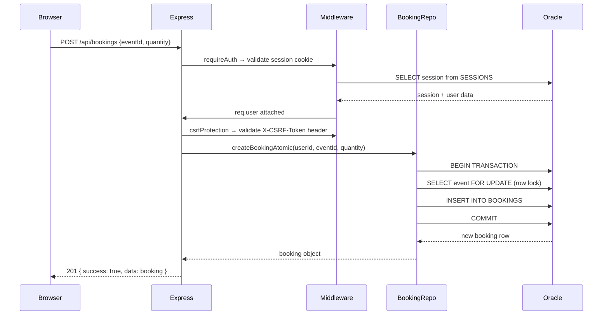
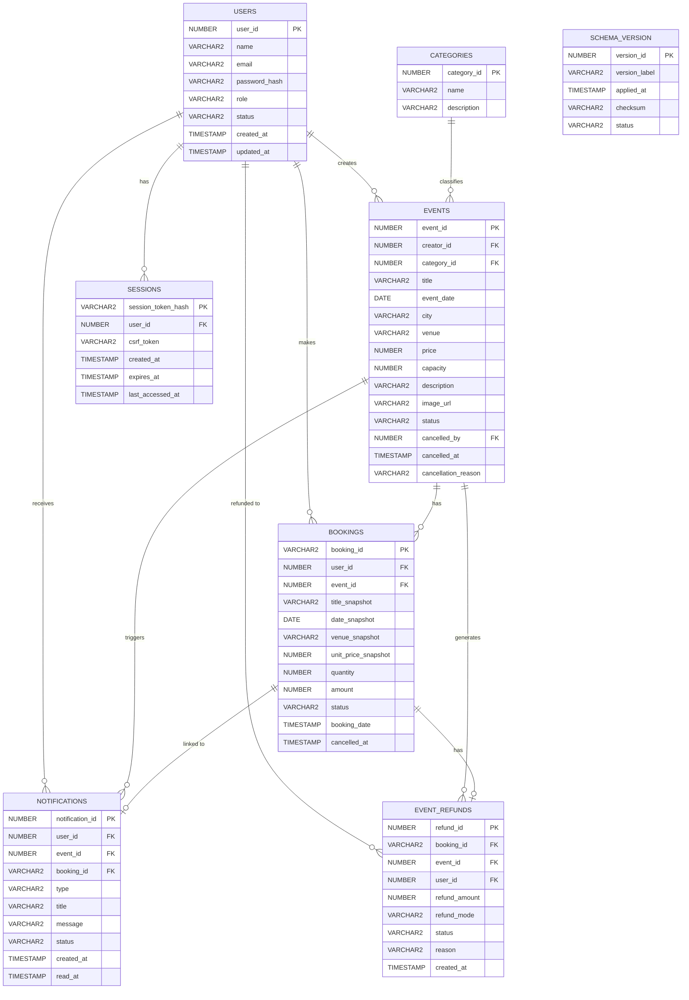

# 🎉 Eventify — Event Management & Ticket Booking Platform

> **B.Tech DBMS Project** — A full-stack event management web application built with Node.js, Express, and Oracle Database 23ai Free.

Eventify lets visitors discover events, registered attendees book tickets, organizers create and manage their own events, and admins oversee the entire platform — all backed by a fully relational Oracle database with transactional integrity.

---

## 📋 Table of Contents

- [✨ Features](#-features)
- [🛠️ Technology Stack](#️-technology-stack)
- [🏗️ Application Architecture](#️-application-architecture)
- [📁 Project Directory Structure](#-project-directory-structure)
- [🗄️ Database Design](#️-database-design)
- [⚙️ Oracle Database Setup (Windows)](#️-oracle-database-setup-windows)
- [🔐 Environment Variables](#-environment-variables)
- [🚀 Installation & Running](#-installation--running)
- [👤 Development Sample Accounts](#-development-sample-accounts)
- [📡 API Reference](#-api-reference)
- [📏 Business Rules](#-business-rules)
- [🔒 Security Features](#-security-features)
- [🧪 Testing & Verification](#-testing--verification)
- [🐛 Troubleshooting](#-troubleshooting)
- [⚠️ Current Limitations](#️-current-limitations)
- [🔮 Future Improvements](#-future-improvements)
- [👨‍💻 Contributors & Academic Context](#-contributors--academic-context)
- [📄 License](#-license)

---

## ✨ Features

### 🙋 Public Visitor
- Browse all published events on the homepage.
- Filter events by category (Technology, Music, Workshop, Business, Sports, Conference).
- Search events by keyword with real-time debounce and auto-scroll to results.
- View full event details: date, venue, city, price, capacity, description, and a category-matched banner photo.

### 🎫 Attendee (Registered User)
- Register a new account (public self-registration assigns the ATTENDEE role).
- Log in and log out with session-based authentication.
- Book tickets to any published event (1–10 tickets per booking).
- View all personal bookings with title, date, venue, and status snapshots.
- Cancel a personal booking.
- Receive persistent in-app notifications when an event they booked is cancelled.
- Dismiss notifications.

### 🗂️ Organizer
- Create new events with full details (title, category, date, time, city, venue, price, capacity, description, image).
- View and manage only their own events in the Organizer Dashboard ("My Events").
- Edit their events (title and price are locked after bookings exist to protect attendees).
- Cancel their own events (cancels all attendee bookings, records simulated refunds, and generates notifications for all affected attendees).
- Cannot book their own events.

### 🛡️ Admin
- Access the Admin Dashboard with platform-wide statistics.
- View all bookings platform-wide.
- Cancel any event regardless of creator.
- Full read access to all data.

---

## 🛠️ Technology Stack

| Layer | Technology |
|---|---|
| **Runtime** | Node.js (CommonJS) |
| **Web Framework** | Express.js 4.x |
| **Database** | Oracle Database 23ai Free |
| **Oracle Driver** | node-oracledb 26.x (Thin mode — no Oracle Client required) |
| **Password Hashing** | bcryptjs |
| **Environment Config** | dotenv |
| **CORS** | cors |
| **Frontend** | Vanilla HTML5, CSS3, JavaScript (no build tools) |
| **Session Storage** | Oracle `SESSIONS` table (custom cookie-based sessions) |
| **CSRF Protection** | Double-submit cookie pattern |

> **No frontend build step.** The `public/` directory is served as static files directly by Express. No Webpack, Vite, or React — just plain HTML, CSS, and JS.

---

## 🏗️ Application Architecture

```
┌─────────────────────────────────────────────────────┐
│                  Browser (Client)                   │
│  HTML + CSS + Vanilla JS  (public/)                 │
│  ┌─────────┐ ┌───────────┐ ┌──────────┐            │
│  │ index   │ │ organizer │ │  admin   │  ...        │
│  │ .html   │ │   .html   │ │  .html   │            │
│  └────┬────┘ └─────┬─────┘ └────┬─────┘            │
│       │            │            │                   │
│    fetch() REST API calls (JSON)                    │
└───────┼────────────┼────────────┼───────────────────┘
        │            │            │
        ▼            ▼            ▼
┌─────────────────────────────────────────────────────┐
│              Express Server  (server.js)            │
│                                                     │
│  Middleware Stack:                                  │
│  CORS → JSON body → Cookie parser → Session auth   │
│                                                     │
│  Route Modules (src/routes/)                        │
│  ┌──────────┐ ┌────────┐ ┌──────────┐ ┌─────────┐ │
│  │  auth    │ │ events │ │bookings  │ │  notif  │ │
│  │ .routes  │ │.routes │ │ .routes  │ │.routes  │ │
│  └────┬─────┘ └───┬────┘ └────┬─────┘ └────┬────┘ │
│       │           │           │             │      │
│  Repository Layer (src/db/repositories/)           │
│  ┌──────────────────────────────────────────────┐  │
│  │  userRepo  │  eventRepo  │  bookingRepo  │  │  │
│  │  sessionRepo │ notifRepo │  adminRepo    │  │  │
│  └───────────────────────┬──────────────────────┘  │
│                          │                         │
│  Database Module  (db.js)                          │
│  executeQuery() / withTransaction()                │
└──────────────────────────┼──────────────────────────┘
                           │
                           ▼
┌─────────────────────────────────────────────────────┐
│         Oracle Database 23ai Free                   │
│  USERS │ CATEGORIES │ EVENTS │ BOOKINGS             │
│  SESSIONS │ NOTIFICATIONS │ EVENT_REFUNDS           │
│  SCHEMA_VERSION                                     │
└─────────────────────────────────────────────────────┘
```

### Request Flow (example: Book a Ticket)



---

## 📁 Project Directory Structure

```
Eventify-Event-Management-Platform/
│
├── server.js                    # Express app entry point, route wiring
├── db.js                        # Oracle connection pool, executeQuery, withTransaction
├── package.json                 # Dependencies & npm scripts
├── .env.example                 # Environment variable template (copy to .env)
├── .gitignore
│
├── scripts/
│   ├── migrate.js               # CLI: runs DB schema migrations
│   └── seed.js                  # CLI: seeds development accounts & events
│
├── src/
│   ├── routes/
│   │   ├── auth.routes.js       # POST /register, /login, /logout; GET /me, /csrf
│   │   ├── events.routes.js     # GET /events, POST /events, PUT /events/:id, POST /events/:id/cancel
│   │   ├── bookings.routes.js   # GET /bookings, POST /bookings, POST /bookings/:id/cancel
│   │   ├── notifications.routes.js  # GET /notifications, POST /notifications/:id/dismiss
│   │   ├── admin.routes.js      # GET /admin/stats
│   │   ├── categories.routes.js # GET /categories
│   │   └── health.routes.js     # GET /health
│   │
│   ├── middleware/
│   │   ├── auth.middleware.js   # requireAuth, requireRole, csrfProtection, session/cookie middleware
│   │   └── error.middleware.js  # 404 handler, global error handler
│   │
│   ├── db/
│   │   ├── schema.sql           # Full Oracle DDL (USERS, CATEGORIES, EVENTS, BOOKINGS, etc.)
│   │   ├── migrator.js          # Forward-only migration engine with checksum validation
│   │   ├── seeder.js            # Idempotent development data seeder
│   │   ├── migrations/
│   │   │   └── v1.1.0__cancellation_notifications_refunds.sql
│   │   └── repositories/
│   │       ├── index.js         # Exports all repositories
│   │       ├── user.repository.js
│   │       ├── session.repository.js
│   │       ├── event.repository.js
│   │       ├── booking.repository.js
│   │       ├── notification.repository.js
│   │       ├── category.repository.js
│   │       └── admin.repository.js
│   │
│   └── data/
│       └── mock-data.js         # Static seed data definitions
│
└── public/                      # Static frontend (served by Express)
    ├── index.html               # Explore Events (homepage)
    ├── event.html               # Event detail page
    ├── login.html               # Login page
    ├── register.html            # Registration page
    ├── bookings.html            # Attendee: My Bookings
    ├── organizer.html           # Organizer Dashboard: My Events
    ├── admin.html               # Admin Dashboard
    │
    ├── js/
    │   ├── app.js               # Homepage: event cards, search, category filter, auto-scroll
    │   ├── event.js             # Event detail: booking widget, cancel booking
    │   ├── organizer.js         # Organizer dashboard: create, edit, cancel events
    │   ├── booking.js           # My Bookings page: list, cancel booking
    │   ├── admin.js             # Admin dashboard: stats display
    │   ├── nav.js               # Shared navigation bar (auth state, role-based links)
    │   ├── auth.js              # Login & register form logic
    │   ├── api.js               # Centralised fetch wrapper (CSRF injection, JSON handling)
    │   └── category-photos.js   # Category-to-photo registry for deterministic image fallback
    │
    ├── css/
    │   ├── style.css            # Global styles, event cards, homepage
    │   ├── event.css            # Event detail page styles
    │   ├── organizer.css        # Organizer dashboard styles
    │   ├── bookings.css         # My Bookings page styles
    │   ├── auth.css             # Login/register form styles
    │   └── admin.css            # Admin dashboard styles
    │
    └── images/
        └── categories/          # Local category banner photos (4 per category)
            ├── technology/      # technology-1.jpg … technology-4.jpg
            ├── music/           # music-1.jpg … music-4.jpg
            ├── workshop/        # workshop-1.jpg … workshop-4.jpg
            ├── business/        # business-1.jpg … business-4.jpg
            ├── sports/          # sports-1.jpg … sports-4.jpg
            └── conference/      # conference-1.jpg … conference-4.jpg
```

---

## 🗄️ Database Design

### Entity-Relationship Diagram



### Key Schema Decisions

| Design Choice | Explanation |
|---|---|
| `BOOKINGS.booking_id` is `VARCHAR2` with format `EVT-{seq}` | Human-readable booking reference using a dedicated Oracle sequence |
| `BOOKINGS` stores title/date/venue/price **snapshots** | Protects booking records if event details change later |
| `EVENTS.cancelled_by` / `cancelled_at` | Audit trail for who cancelled and when |
| `SESSIONS` table in Oracle | No external session store (e.g., Redis) needed; sessions are persisted transactionally |
| `EVENT_REFUNDS.refund_mode = 'SIMULATED'` | No payment gateway; refunds are tracked for accounting purposes only |
| `SCHEMA_VERSION` with checksums | Prevents partial migrations; detects file tampering |

---

## ⚙️ Oracle Database Setup (Windows)

> **This is the most involved step.** Follow carefully. The application will still start without Oracle (in offline mode), but all database-backed features will be unavailable.

### Step 1 — Install Oracle Database 23ai Free

1. Download **Oracle Database 23ai Free** from the official Oracle website:
   [https://www.oracle.com/database/free/](https://www.oracle.com/database/free/)

2. Run the installer (`OracleDB23aiFree-Win64.exe`). During installation:
   - Note the **SYS password** you set (you will need it).
   - The installer creates a Pluggable Database (PDB) named **`FREEPDB1`**.

3. After installation, Oracle services should start automatically. You can verify in **Windows Services** (`services.msc`) — look for `OracleServiceFREE`.

### Step 2 — Create the Application Schema User

Open a terminal and connect to Oracle as SYSDBA:

```powershell
sqlplus sys/YOUR_SYS_PASSWORD@localhost:1521/FREEPDB1 as sysdba
```

Once connected, run these SQL commands to create the Eventify database user:

```sql
-- Create user
CREATE USER eventify_admin IDENTIFIED BY "YourSecurePassword123";

-- Grant permissions
GRANT CONNECT, RESOURCE TO eventify_admin;
GRANT CREATE SESSION TO eventify_admin;
GRANT UNLIMITED TABLESPACE TO eventify_admin;

-- Exit SQL*Plus
EXIT;
```

> Replace `YourSecurePassword123` with a strong password. You will put this in your `.env` file.

### Step 3 — Initialize the Schema

Run the base schema (creates all tables, constraints, and indexes):

```powershell
sqlplus eventify_admin/"YourSecurePassword123"@localhost:1521/FREEPDB1 @src/db/schema.sql
```

You should see Oracle confirmation messages for each `CREATE TABLE` statement. If you see errors like `ORA-00955: name is already used`, the tables already exist — that is fine.

### Step 4 — Run Database Migrations

Migrations apply incremental schema changes on top of the base schema. Set up your `.env` first (see [Environment Variables](#-environment-variables)), then run:

```powershell
node scripts/migrate.js
```

This applies `v1.1.0__cancellation_notifications_refunds.sql` (adds NOTIFICATIONS and EVENT_REFUNDS tables). The migrator is idempotent — running it again is safe.

### Step 5 — Seed Development Data

```powershell
node scripts/seed.js
```

This creates 6 event categories, 4 development user accounts, and 10 sample events. The seeder is idempotent (safe to re-run).

> **Note:** The seed script refuses to run if `NODE_ENV=production`. This is intentional — development accounts must never exist in production.

### Verifying the Setup

```powershell
sqlplus eventify_admin/"YourSecurePassword123"@localhost:1521/FREEPDB1
```

```sql
SELECT table_name FROM user_tables ORDER BY table_name;
SELECT COUNT(*) FROM USERS;
SELECT COUNT(*) FROM EVENTS;
SELECT COUNT(*) FROM CATEGORIES;
EXIT;
```

Expected output: 8 tables, 4+ users, 10 events, 6 categories.

---

## 🔐 Environment Variables

Copy `.env.example` to `.env` and fill in your values:

```powershell
Copy-Item .env.example .env
```

Then edit `.env`:

```env
# Server
PORT=3000
NODE_ENV=development

# Oracle Database
DB_USER=eventify_admin
DB_PASSWORD=YourSecurePassword123
DB_CONNECT_STRING=localhost:1521/FREEPDB1

# Optional: restrict CORS in production (comma-separated)
# ALLOWED_ORIGINS=https://eventify.example.com
```

| Variable | Required | Description |
|---|---|---|
| `PORT` | No | HTTP port (default: `3000`) |
| `NODE_ENV` | No | `development` or `production` (default: `development`) |
| `DB_USER` | **Yes** | Oracle schema user (e.g., `eventify_admin`) |
| `DB_PASSWORD` | **Yes** | Oracle user password |
| `DB_CONNECT_STRING` | **Yes** | Oracle connection string (e.g., `localhost:1521/FREEPDB1`) |
| `ALLOWED_ORIGINS` | No | Comma-separated allowed CORS origins for production |

> **Never commit `.env` to Git.** It is listed in `.gitignore`. Only `.env.example` is tracked.

---

## 🚀 Installation & Running

### Prerequisites

- Node.js 18+ (download from [https://nodejs.org](https://nodejs.org))
- Oracle Database 23ai Free (see [Oracle Database Setup](#️-oracle-database-setup-windows) above)
- A terminal (PowerShell on Windows)

### Quick Start

```powershell
# 1. Clone or unzip the project
cd Eventify-Event-Management-Platform

# 2. Install Node.js dependencies
npm install

# 3. Configure environment (copy template, then edit with your DB password)
Copy-Item .env.example .env

# 4. Initialize database schema (first time only)
sqlplus eventify_admin/"YourPassword"@localhost:1521/FREEPDB1 @src/db/schema.sql

# 5. Run migrations (first time only — safe to re-run)
node scripts/migrate.js

# 6. Seed development data (first time only — safe to re-run)
node scripts/seed.js

# 7. Start the application
npm start
```

Open your browser at **[http://localhost:3000](http://localhost:3000)** 🎉

### Development Mode (auto-restart on file changes)

```powershell
npm run dev
```

This uses Node.js's built-in `--watch` flag. No external tools like nodemon are required.

### Application Pages

| Page | URL |
|---|---|
| Explore Events (Home) | http://localhost:3000 |
| Event Detail | http://localhost:3000/event.html?id=1 |
| Login | http://localhost:3000/login.html |
| Register | http://localhost:3000/register.html |
| My Bookings (Attendee) | http://localhost:3000/bookings.html |
| Organizer Dashboard | http://localhost:3000/organizer.html |
| Admin Dashboard | http://localhost:3000/admin.html |

---

## 👤 Development Sample Accounts

> **⚠️ DEVELOPMENT ONLY — NOT FOR PRODUCTION.**
> These accounts are seeded by `node scripts/seed.js` for local development and testing. They do not exist in production (`NODE_ENV=production`).

| Role | Name | Email | Password |
|---|---|---|---|
| Admin | Admin User | `admin@eventify.local` | `Admin@123` |
| Organizer | Alex Organizer | `organizer@eventify.local` | `Organizer@123` |
| Organizer | Priya Organizer | `organizer2@eventify.local` | `Organizer2@123` |
| Attendee | Test Attendee | `attendee@eventify.local` | `Attendee@123` |

> Public registration always creates ATTENDEE accounts. ORGANIZER and ADMIN roles must be provisioned through the seeder or direct database operations.

---

## 📡 API Reference

All API endpoints are under `/api`. Responses follow the structure:
- **Success:** `{ "success": true, "data": {...} }` or `{ "success": true, "count": N, "data": [...] }`
- **Error:** `{ "success": false, "message": "...", "code": "ERROR_CODE" }`

### 🔑 Authentication — `/api/auth`

| Method | Endpoint | Auth | Description |
|---|---|---|---|
| `GET` | `/api/auth/csrf` | None | Get the current CSRF token for the session |
| `POST` | `/api/auth/register` | None (+ CSRF) | Register a new ATTENDEE account |
| `POST` | `/api/auth/login` | None (+ CSRF) | Log in with email and password |
| `POST` | `/api/auth/logout` | Session (+ CSRF) | Log out and invalidate session |
| `GET` | `/api/auth/me` | Session | Get current authenticated user identity |

**Register / Login request body:**
```json
{
  "name": "Jane Doe",
  "email": "jane@example.com",
  "password": "SecurePass123"
}
```

---

### 📅 Events — `/api/events`

| Method | Endpoint | Auth | Description |
|---|---|---|---|
| `GET` | `/api/events` | None | List published events (filter by `?category=` or `?search=`) |
| `GET` | `/api/events/:id` | None | Get a single event by ID |
| `POST` | `/api/events` | ORGANIZER / ADMIN + CSRF | Create a new event |
| `PUT` | `/api/events/:id` | ORGANIZER (creator) / ADMIN + CSRF | Edit an existing event |
| `POST` | `/api/events/:id/cancel` | ORGANIZER (creator) / ADMIN + CSRF | Cancel an event |

**Create / Edit event body fields:**

| Field | Type | Required | Notes |
|---|---|---|---|
| `title` | string | Yes (create) | Min 2 characters; locked after bookings exist |
| `category` | string | Yes (create) | Category name, e.g. `"Technology"` |
| `categoryId` | number | Yes (create) | Alternative: category ID instead of name |
| `date` | string | Yes (create) | Format: `YYYY-MM-DD` |
| `time` | string | No | Format: `HH:mm` (e.g. `18:30`) |
| `city` | string | No | Default: `Surat` |
| `venue` | string | No | Default: `Main Auditorium` |
| `price` | number | No | Non-negative; default: `0`. Locked after bookings exist |
| `capacity` | number | No | Min: `1`; default: `100`. Cannot reduce below already-booked quantity |
| `description` | string | No | Event description |
| `imageUrl` | string | No | Custom image URL |

**Cancel event body:**
```json
{ "reason": "Venue unavailable (optional, max 500 chars)" }
```

---

### 🎟️ Bookings — `/api/bookings`

| Method | Endpoint | Auth | Description |
|---|---|---|---|
| `GET` | `/api/bookings` | Session | List own bookings (ADMIN sees all) |
| `POST` | `/api/bookings` | Session + CSRF | Create a new booking |
| `POST` | `/api/bookings/:id/cancel` | Session + CSRF | Cancel a booking (owner or ADMIN) |

**Create booking request body:**
```json
{ "eventId": 5, "quantity": 2 }
```

---

### 🔔 Notifications — `/api/notifications`

| Method | Endpoint | Auth | Description |
|---|---|---|---|
| `GET` | `/api/notifications` | Session | Get current user's notifications (filter: `?status=UNREAD`) |
| `POST` | `/api/notifications/:id/dismiss` | Session + CSRF | Dismiss a notification |

---

### 🛡️ Admin — `/api/admin`

| Method | Endpoint | Auth | Description |
|---|---|---|---|
| `GET` | `/api/admin/stats` | ADMIN only | Platform-wide statistics |

---

### 🗂️ Categories — `/api/categories`

| Method | Endpoint | Auth | Description |
|---|---|---|---|
| `GET` | `/api/categories` | None | List all event categories |

---

### ❤️ Health — `/api/health`

| Method | Endpoint | Auth | Description |
|---|---|---|---|
| `GET` | `/api/health` | None | Server and Oracle DB connection status |

---

## 📏 Business Rules

1. **Registration role:** Public registration always creates ATTENDEE accounts. The role field from the request body is ignored.

2. **Event editing restrictions:** Once an event has at least one confirmed booking:
   - The **title** cannot be changed (attendee receipts reference the original title snapshot).
   - The **price** cannot be changed (attendees booked at a specific price).
   - The **capacity** cannot be reduced below the number of tickets already sold.

3. **Event cancellation cascade:** When an event is cancelled:
   - All `CONFIRMED` bookings for that event are set to `CANCELLED`.
   - A `SIMULATED` refund record is created in `EVENT_REFUNDS` for each cancelled paid booking.
   - A persistent `EVENT_CANCELLED` notification is created in `NOTIFICATIONS` for each affected attendee.
   - The event status is set to `CANCELLED` with `cancelled_by`, `cancelled_at`, and `cancellation_reason` recorded.

4. **Owner self-booking prevention:** The event creator (organizer) cannot book their own event.

5. **Organizer ownership:** An organizer can only edit or cancel events they created. A different organizer receives HTTP 403.

6. **Admin override:** ADMIN can cancel any event regardless of creator.

7. **Booking quantity:** Minimum 1, maximum 10 tickets per booking.

8. **Capacity enforcement:** Bookings are rejected with `INSUFFICIENT_CAPACITY` if adding the requested quantity would exceed the event's remaining capacity. This check uses an Oracle row lock (`SELECT FOR UPDATE`) to prevent race conditions.

9. **Booking ID format:** Booking IDs follow the pattern `EVT-{sequential_number}` (e.g., `EVT-2001`).

---

## 🔒 Security Features

| Feature | Implementation |
|---|---|
| **Password hashing** | bcryptjs with 10 salt rounds — passwords are never stored in plaintext |
| **Session management** | Custom Oracle-backed sessions; session token stored as a SHA-256 hash in the `SESSIONS` table |
| **CSRF protection** | Double-submit cookie pattern — all write endpoints require a `X-CSRF-Token` header matching the session's CSRF token |
| **Role-based access** | `requireRole(...)` middleware enforces ORGANIZER/ADMIN roles on protected routes; `requireAuth` enforces any authenticated session |
| **Ownership checks** | Server-side ownership validation on edit/cancel — client-supplied user IDs are ignored; identity comes only from the verified session |
| **Input validation** | All user inputs are validated server-side before hitting the database |
| **SQL injection prevention** | All Oracle queries use bind parameters — never string concatenation |
| **XSS prevention** | Frontend renders user content via `textContent` and `innerText` (not `innerHTML`) for untrusted data |
| **Concurrency safety** | Event capacity and cancellation use Oracle `SELECT FOR UPDATE` row locking within transactions |
| **Production guard** | Seed script refuses to run when `NODE_ENV=production` |
| **Cookie security** | Session and CSRF cookies are `SameSite=Lax`; `HttpOnly` and `Secure` flags are set in production |

---

## 🧪 Testing & Verification

This project does not include automated unit/integration tests. Use the following manual verification scenarios:

### 1. Health Check
```powershell
Invoke-RestMethod http://localhost:3000/api/health
```
Expected: `{ "success": true, "database": { "connected": true } }`

### 2. Browse Events (Public)
Open [http://localhost:3000](http://localhost:3000) — you should see event cards. Try the search bar and category filters.

### 3. Attendee Flow
1. Register a new account at [http://localhost:3000/register.html](http://localhost:3000/register.html).
2. Log in.
3. Open any event and book 1–2 tickets.
4. Visit [http://localhost:3000/bookings.html](http://localhost:3000/bookings.html) to see the booking.
5. Cancel the booking.

### 4. Organizer Flow
1. Log in as `organizer@eventify.local` / `Organizer@123`.
2. Navigate to the Organizer Dashboard.
3. Create a new event.
4. After creation, the page redirects to Explore Events and highlights the new card.
5. Return to the Organizer Dashboard, open the event, and edit a field.
6. Cancel the event and verify that attendees with bookings receive notifications.

### 5. Authorization Checks
- Log in as `organizer2@eventify.local` and attempt to edit an event created by `organizer@eventify.local` via the API — expect HTTP 403.
- Attempt to book your own event as an organizer — expect HTTP 400 with `OWNER_BOOKING_PROHIBITED`.

### 6. Admin Flow
1. Log in as `admin@eventify.local` / `Admin@123`.
2. Visit [http://localhost:3000/admin.html](http://localhost:3000/admin.html) — verify platform stats are displayed.

### 7. Notifications Flow
1. As an organizer, cancel an event that has at least one attendee booking.
2. Log in as the attendee.
3. Check `GET /api/notifications` — an `EVENT_CANCELLED` notification should appear.
4. Dismiss it via `POST /api/notifications/:id/dismiss`.

---

## 🐛 Troubleshooting

### Server starts but database features don't work

**Symptom:** The server starts, but login, events, or bookings return errors.

**Check 1:** Verify Oracle is running.
```powershell
Get-Service | Where-Object {$_.Name -like "Oracle*"}
```
Start the service if it is stopped:
```powershell
Start-Service OracleServiceFREE
```

**Check 2:** Verify your `.env` file has the correct `DB_USER`, `DB_PASSWORD`, and `DB_CONNECT_STRING`.

**Check 3:** Confirm the connect string matches your PDB. Oracle 23ai Free uses `FREEPDB1`:
```
DB_CONNECT_STRING=localhost:1521/FREEPDB1
```

**Check 4:** Test the Oracle connection directly:
```powershell
sqlplus eventify_admin/"YourPassword"@localhost:1521/FREEPDB1
```

---

### `ORA-01017: invalid username/password`

The credentials in `.env` do not match the Oracle user. Re-verify `DB_USER` and `DB_PASSWORD`.

---

### `ORA-12541: TNS: no listener`

The Oracle listener is not running.
```powershell
# Start listener (run as administrator in cmd, not PowerShell)
lsnrctl start
```

---

### `ORA-00955: name is already used`

The schema already exists (tables were already created). This is not an error — the schema was already initialized. Proceed to run migrations and seed.

---

### Tables missing after running schema.sql

If you ran `schema.sql` and then re-ran it, you may see errors because it uses `CREATE TABLE` (not `CREATE OR REPLACE`). Connect with SQL*Plus and check:
```sql
SELECT table_name FROM user_tables ORDER BY table_name;
```

---

### `npm install` fails

Ensure Node.js 18+ is installed:
```powershell
node --version
```
If the `oracledb` package fails to install, check your Node.js version — oracledb 26.x requires Node.js 14.6+.

---

### CSRF errors on API calls

If you are testing the API directly (e.g., with curl or Postman), you need to:
1. Call `GET /api/auth/csrf` to get a token.
2. Send the token as the `X-CSRF-Token` header in all `POST`/`PUT` write requests.

---

## ⚠️ Current Limitations

| Limitation | Details |
|---|---|
| **No real payment gateway** | All payments and refunds are **SIMULATED**. No actual money is processed. `EVENT_REFUNDS` records are for accounting/audit reference only. |
| **No email notifications** | Cancellation notifications are in-app (database-backed). No emails are sent. |
| **No image upload** | Events use an image URL (a link to an external image or a local path). There is no server-side file upload endpoint. |
| **No pagination** | The events list and bookings list return all records. Large datasets may be slow. |
| **No advanced admin tools** | Admin can view stats and cancel events but cannot directly manage users or suspend accounts through the UI. |
| **Single server** | Designed for a single Node.js process. No clustering or load balancing is implemented. |
| **Development-only accounts** | ORGANIZER and ADMIN accounts must be seeded manually. There is no in-app admin panel to promote users. |

---

## 🔮 Future Improvements

- [ ] Integrate a real payment gateway (Razorpay, Stripe) for genuine ticket purchases and refunds.
- [ ] Add email notifications (Nodemailer / SendGrid) for booking confirmations and event cancellations.
- [ ] Implement server-side image upload (Multer) and cloud storage (AWS S3 / Cloudinary).
- [ ] Add pagination and infinite scroll for the events list.
- [ ] Add an admin panel for user management (suspend, activate, change role).
- [ ] Add event search by city and date range.
- [ ] Build a QR-code-based ticket check-in system for organizers.
- [ ] Add automated tests (Jest + Supertest for API, Playwright for E2E).
- [ ] Deploy to a cloud environment (Oracle Cloud Free Tier + PM2).
- [ ] Add rate limiting (express-rate-limit) and Helmet.js for production hardening.

---

## 👨‍💻 Contributors & Academic Context

**Project:** Eventify — Event Management & Ticket Booking Platform
**Course:** Database Management Systems (DBMS)
**Degree:** Bachelor of Technology (B.Tech)

This project was developed as a DBMS coursework submission to demonstrate:
- Relational database design with normalized schema (3NF).
- Oracle Database 23ai Free with DDL, DML, sequences, indexes, and constraints.
- Transactional integrity with `COMMIT`/`ROLLBACK` and Oracle row locking (`SELECT FOR UPDATE`).
- Forward-only database migration with checksum validation.
- A practical full-stack web application using the repository pattern.

---

## 📄 License

This project is licensed under the **ISC License**.

```
ISC License

Permission to use, copy, modify, and/or distribute this software for any
purpose with or without fee is hereby granted, provided that the above
copyright notice and this permission notice appear in all copies.

THE SOFTWARE IS PROVIDED "AS IS" AND THE AUTHOR DISCLAIMS ALL WARRANTIES
WITH REGARD TO THIS SOFTWARE INCLUDING ALL IMPLIED WARRANTIES OF
MERCHANTABILITY AND FITNESS. IN NO EVENT SHALL THE AUTHOR BE LIABLE FOR
ANY SPECIAL, DIRECT, INDIRECT, OR CONSEQUENTIAL DAMAGES OR ANY DAMAGES
WHATSOEVER RESULTING FROM LOSS OF USE, DATA OR PROFITS, WHETHER IN AN
ACTION OF CONTRACT, NEGLIGENCE OR OTHER TORTIOUS ACTION, ARISING OUT OF
OR IN CONNECTION WITH THE USE OR PERFORMANCE OF THIS SOFTWARE.
```

---

<div align="center">

Built with ❤️ using Node.js, Express, and Oracle Database 23ai Free.

</div>
